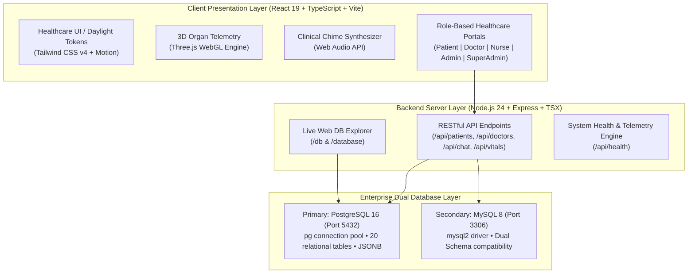
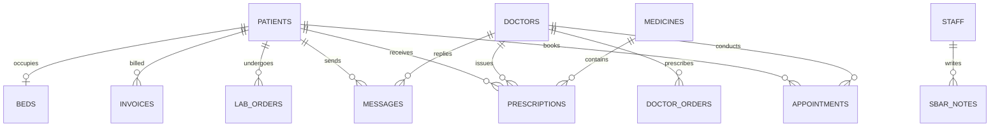
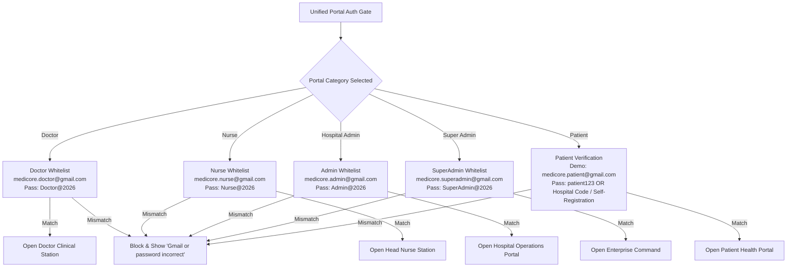

# MediCore OS - Enterprise Hospital Management System (HMS)
## Complete Technical Architecture & Technology Stack Specification

---

> [!NOTE]
> This document provides an exhaustive, production-grade technical breakdown of the entire **MediCore Enterprise HMS** codebase, detailing the frontend, backend, database layer, 3D telemetry graphics, security enforcement, and real-time clinical workflows.

---

## 1. Executive 3D System Architecture


### 3D Layered Infrastructure:
* **Tier 1: Client Presentation Tier (Top Floating Glass Slab)**: 5 interactive 3D terminals (Doctor, Nurse, Admin, Super Admin, Patient 3D Anatomy) rendered with live telemetry widgets (ECG waves, organ telemetry, bed status indicators, and E-Rx creators). Built with React 19, TypeScript, and Three.js WebGL.
* **Tier 2: API & Clinical Intelligence Tier (Middle Compute Layer)**: Express.js RESTful API engine, Web Audio clinical chime synthesizer, bidirectional real-time consultation chat bridge, and Google Gemini clinical AI core connected via illuminated cyan and medical blue data conduits.
* **Tier 3: Enterprise Data Tier (Bottom Storage Platform)**: PostgreSQL 16 database cluster with glowing cyan rings, 20 relational clinical tables, JSONB telemetry memory cubes, and dual-sync replication to MySQL on port 5432.



### High-Level Stack Matrix

| Category | Primary Technology | Version | Purpose & Role in MediCore HMS |
| :--- | :--- | :--- | :--- |
| **Frontend Framework** | React | `v19.0.1` | Concurrent rendering, component-driven reactive state architecture |
| **Language** | TypeScript | `v7.0.2` | Full static type safety, domain model contracts across frontend & backend |
| **Build System & Dev Server** | Vite | `v8.3.0` | Sub-millisecond HMR (Hot Module Replacement), ES module bundling |
| **CSS & Design System** | Tailwind CSS & Modern CSS | `v4.3.3` | Daylight Healthcare design tokens, glassmorphism, responsive grid |
| **Motion & Animation** | Motion (Framer Motion) | `v12.23.24` | Fluid portal transitions, slide-in clinical modals, telemetry pulses |
| **3D Graphics Engine** | Three.js | `v0.187.0` | WebGL 3D interactive human anatomy, cardiovascular/thoracic hotspots |
| **Iconography** | Lucide React | `v0.546.0` | 200+ specialized medical, diagnostic, bed, and hospital icons |
| **Backend Runtime** | Node.js | `v24.x` | High-throughput asynchronous event-driven I/O server runtime |
| **Backend Web Framework** | Express | `v4.21.2` | RESTful routing, CORS management, JSON request processing |
| **TypeScript Execution** | TSX | `v4.21.0` | Native zero-build TypeScript execution for server processes |
| **Primary Database** | PostgreSQL | `16.x` | Primary relational database (`medicore_db`), JSONB vitals, ACID compliance |
| **Secondary Database** | MySQL | `8.x` | Alternate relational database option with dual schema parity |
| **Database Drivers** | `pg` & `mysql2` | `8.23` / `3.24` | Native connection pooling, parameterized query security |
| **Audio Synthesizer** | Web Audio API | Native Browser | Call bell rings, critical code alerts, click & success feedback |
| **AI Integration** | Google Gemini API | `@google/genai` | Intelligent triage analysis, symptom checking, clinical summaries |

---

## 2. Frontend Architecture (Presentation Tier)

### 2.1 Component Architecture & Routing
The frontend operates on a single-page application (SPA) architecture with an intelligent state-based portal orchestrator in [`App.tsx`](file:///c:/Users/ADMIN/Downloads/HMS-main/HMS-main/src/App.tsx).

```
src/
├── components/
│   ├── 3d/                     # Three.js 3D human anatomy viewer & organ systems
│   ├── analytics/              # Hospital occupancy, revenue, and department reports
│   ├── appointments/           # Appointment scheduler & telehealth dispatch
│   ├── auth/                   # UnifiedPortalAuth enterprise authentication gate
│   ├── beds/                   # Bed census, ICU telemetry, and ward allocation
│   ├── billing/                # Tax invoices, claims, and insurance processing
│   ├── dashboard/              # Hospital Admin operations & city-care widgets
│   ├── doctor-portal/          # Doctor Clinical Station, SOAP notes, and Tele-Chat
│   ├── doctors/                # Medical staff directory, credentials, and rosters
│   ├── emr/                    # Electronic Medical Records & clinical journey
│   ├── export/                 # Printable PDF prescriptions, invoices & health cards
│   ├── laboratory/             # Diagnostic orders, pathology tests, and results
│   ├── navigation/             # TopBar, Daylight Sidebar, Command Palette (Ctrl+K)
│   ├── nurse-portal/           # Head Nurse station, MEWS score, and MAR records
│   ├── patient-portal/         # Self-service portal: appointments, Rx, 3D, chat
│   ├── patients/               # Inpatient / Outpatient directory & onboarding
│   ├── pharmacy/               # Drug catalog, inventory, refills, and batch expiry
│   ├── settings/               # System preferences, audit logs, and security controls
│   └── super-admin/            # Multi-facility governance, node telemetry, and audit
├── services/
│   ├── api.ts                  # Axios/Fetch client connecting to Express backend
│   ├── audioService.ts         # Web Audio API clinical chimes & warning synthesis
│   └── mockDatabase.ts         # Hybrid in-memory fallback & reactive subscriber engine
└── types/
    └── index.ts                # TypeScript domain models (Patient, Doctor, Bed, etc.)
```

### 2.2 Color System & Design Language (DocR Daylight Specification)
MediCore enforces a daylight clinical aesthetic designed for medical readability:

* **Primary Steel Slate Accent**: `#3B4E6A` (Sidebar, active badges, portal headers)
* **Secondary Slate Neutral**: `#475569` (Secondary labels, borders)
* **Background Surface**: `#F4F7F8` (Light daylight canvas, zero eye strain)
* **Clinical Surface White**: `#FFFFFF` (Clean cards, rounded containers)
* **Status Signaling**:
  * Emergency / Critical: `#EF4444` (Call lights, ICU alerts, low $SpO_2$)
  * Optimal / Normal: `#10B981` (Stable vitals, available beds)
  * Warning / In Progress: `#F59E0B` (Admissions pending, moderate risk)

---

## 3. Database Architecture & Schema Tier

The system utilizes **PostgreSQL 16** on port `5432` as the primary enterprise database, with automated fallback and sync capabilities to MySQL 8.



### 3.1 Relational Schema Definitions (20 Core Tables)

1. **`patients`**: Inpatient & outpatient demographics, `patient_code` (e.g. `P-10023`), admission status (`Admitted`, `ICU`, `Outpatient`, `Discharged`), attending physician, and JSONB vitals telemetry (`blood_pressure`, `pulse_rate`, `oxygen_saturation`, `temperature`, `hba1c`, `cholesterol`).
2. **`doctors`**: Physician profiles, department, specialty, consultation fees, experience, ratings, and schedule blocks.
3. **`staff`**: Nurses, technicians, administrative officers, duty shifts, and contact information.
4. **`beds`**: Ward name, bed number (e.g. `ICU-02`, `GEN-04`), type (`ICU`, `General`, `Emergency`), status (`Available`, `Occupied`, `Cleaning`), and assigned patient.
5. **`appointments`**: Scheduling ledger connecting patients and physicians with visit modality (`Consultation`, `Follow-up`, `Telehealth`).
6. **`prescriptions`**: Electronic prescriptions with dosages, frequencies, duration, and pharmacy dispensing state.
7. **`medicines`**: Formulary drug database, ATC classification, stock count, reorder triggers, and expiry tracking.
8. **`invoices`**: Financial accounting, billing lines, insurance coverage percentage, and payment status (`Paid`, `Pending`).
9. **`lab_orders` & `lab_tests`**: Diagnostic scans, blood panels, specimen telemetry, and pathological sign-offs.
10. **`messages`**: Real-time consultation messages with sender role, recipient, timestamp, and status.
11. **`sbar_notes`**: Situation, Background, Assessment, Recommendation nursing handoff logs.
12. **`mar_records`**: Medication Administration Records confirming bedside dosage delivery.
13. **`doctor_orders`**: Bedside orders for fluids, diet restrictions, oxygen titration, and stat medications.
14. **`discharged_patients`**: Historical census archive with discharge summaries, total length of stay, and outcome notes.
15. **`claims`**: Health insurance claim submissions, pre-authorization codes, and reimbursement tracking.
16. **`immunizations`**: Digital immunization passport logs with batch numbers and booster schedules.
17. **`meals`**: Inpatient dietary nutrition tracking and clinical calorie allocations.
18. **`alerts`**: Emergency call lights, code blue triggers, and clinical deterioration events.
19. **`audit_logs`**: HIPPA/NABH compliance trail recording logins, role switches, and patient record accesses.

---

## 4. Security & Role-Based Access Control (RBAC)

MediCore enforces strict multi-tenant role segmentation:



### Official Management Credentials Directory

| Role | Portal Category | Official Management Gmail | Password | Access Scope |
| :--- | :--- | :--- | :--- | :--- |
| **Chief of Cardiology** | Doctor Portal | `medicore.doctor@gmail.com` | `Doctor@2026` | Clinical station, patient rounds, E-Rx, Tele-Chat |
| **Head Nurse (BSN, RN)**| Nurse Portal | `medicore.nurse@gmail.com` | `Nurse@2026` | Bed census, MEWS triage, MAR administration |
| **Chief Administrator** | Hospital Admin | `medicore.admin@gmail.com` | `Admin@2026` | Operations, staff rosters, billing, bed management |
| **Enterprise Director** | Super Admin | `medicore.superadmin@gmail.com` | `SuperAdmin@2026` | Multi-hospital command, audit logs, system config |
| **Patient (Demo / Staff-Registered)** | Patient Portal | `medicore.patient@gmail.com` *(or Code `P-10001`)* | `patient123` | Personal records, appointments, telehealth chat |

> [!IMPORTANT]
> Any unauthorized Gmail address or incorrect password entered into any management portal is strictly denied with a security alert: **"Gmail or password incorrect. Only management-issued credentials can access this portal."**

---

## 5. Clinical Intelligence & Specialized Modules

### 5.1 3D Anatomical Telemetry Engine (Three.js WebGL)
* **Real-time Organ Telemetry**: Renders 3D anatomical models of the heart, lungs, and digestive tract.
* **Interactive Hotspots**: Allows clinicians and patients to click anatomical landmarks to view blood flow velocity, myocardial perfusion, and localized clinical risk factors.
* **Shader & Lighting**: Customized directional ambient lighting with depth shadows optimized for daylight rendering.

### 5.2 MEWS (Modified Early Warning Score) Engine
In [`HeadNursePortal.tsx`](file:///c:/Users/ADMIN/Downloads/HMS-main/HMS-main/src/components/nurse-portal/HeadNursePortal.tsx), an automated clinical algorithm computes patient deterioration risk scores:
$$\text{MEWS} = f(\text{Systolic BP}) + f(\text{Heart Rate}) + f(\text{Respiratory Rate}) + f(\text{Temperature}) + f(\text{AVPU Consciousness})$$
* **Score 0 - 2**: Low Risk (Routine 4-hour observations)
* **Score 3 - 4**: Medium Risk (Urgent nursing escalation & doctor review within 30 mins)
* **Score $\ge 5$**: High Critical Risk (Stat Medical Emergency Team / ICU alert dispatched)

### 5.3 Bidirectional Real-Time Consultation Chat
* **Patient-to-Doctor Tele-Chat**: Seamless real-time messaging bridge linking [`PatientPortal.tsx`](file:///c:/Users/ADMIN/Downloads/HMS-main/HMS-main/src/components/patient-portal/PatientPortal.tsx) directly to [`DoctorPortal.tsx`](file:///c:/Users/ADMIN/Downloads/HMS-main/HMS-main/src/components/doctor-portal/DoctorPortal.tsx).
* **Viewport Pinning**: Fixed-height chat viewport preventing page jumping during rapid message exchanges.
* **Audio Telemetry**: Dual-frequency Web Audio tone chime notifying physicians upon receiving new patient inquiries.

---

## 6. Execution & Deployment Runbook

### Prerequisites
* **Node.js**: v18.x or v20.x or v24.x
* **PostgreSQL**: 14+ or 16+ running on `127.0.0.1:5432` (Database: `medicore_db`)
* **Package Manager**: npm or yarn

### Launch Commands
```bash
# 1. Install Dependencies
npm install

# 2. Start PostgreSQL 16 Backend Server (Port 5000)
npm run server

# 3. Start Vite Frontend Development Server (Port 3000)
npm run dev
```

### Access URLs
* **Frontend Application**: `http://localhost:3000`
* **Backend Health Check**: `http://localhost:5000/api/health`
* **Live Web Database Explorer**: `http://localhost:5000/db`
* **Desktop PostgreSQL Explorer**: Double click `View_PostgreSQL_Data.bat` on Desktop
